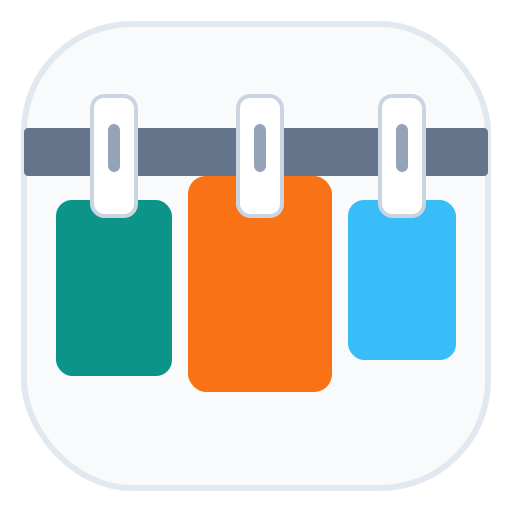

<p align="center">
  
</p>

<h1 align="center">Mansher</h1>

<p align="center"><strong>Screenshots, hung out to dry, on Linux.</strong></p>

<p align="center">
  <a href="https://github.com/TAGOOZ/Mansher/actions/workflows/ci.yml"></a>
  
</p>

Every screenshot you take hangs on a clothesline at the top of your screen.
Click to copy, right-click for actions, drag to share, cross to let it go.

## Features

- Clothesline overlay for screenshots, with layer-shell on Niri, Sway, Hyprland, and KDE, plus a fallback window everywhere else, including GNOME and X11
- Click a shot to copy it to the clipboard, right-click for keep, trash, and share actions
- Drag shots out as real files, hover for a closer look
- Watches your screenshots folder, desktop, and clipboard, so any capture tool feeds it: grim plus slurp, GNOME Screenshot, Spectacle, Flameshot
- System tray menu and a Preferences window, also reachable at `mansher-app --preferences`
- Sounds and launch-at-login settings, per-folder watching, adjustable line length
- Environment report at `mansher-app --doctor` that tells you what the app can see when shots stop arriving
- Private by design: no account, no network, no analytics

## Install

Download `Mansher-x86_64.AppImage` from the
[releases](https://github.com/TAGOOZ/Mansher/releases) page, make it
executable, and run it. No install step, no root, no runtime to fetch.

```sh
chmod +x Mansher-x86_64.AppImage
./Mansher-x86_64.AppImage
```

## Use

Take a screenshot with your usual tool. It lands on the line within a second.
Press your toggle keybind (or run `mansher-app --toggle`) to show or hide the
line. Open Preferences from the tray, or run `mansher-app --preferences`
where no tray exists. Run `mansher-app --doctor` first whenever behavior
surprises you.

## Build from source

```sh
# Core only, works anywhere:
cargo test -p mansher-core

# Full UI needs GTK4 dev headers:
# Ubuntu/Debian: sudo apt install libgtk-4-dev libadwaita-1-dev
# Fedora:        sudo dnf install gtk4-devel libadwaita-devel
# Arch:          sudo pacman -S gtk4 libadwaita
cargo build --release -p mansher-app
```

GTK4 0.11 needs Rust 1.92 or newer. The Flatpak manifest under `flatpak/`
pins its own SDK, so Flathub builds ignore your local toolchain.

## Thanks

Mansher is the Linux clone of [Tendedero](https://github.com/alejandrobujan/tendedero)
(macOS) by Alejandro Bujan. The idea, the interaction language, and the
courage to keep it small all come from his work. Thank you, Alejandro.

Name note: Tendedero code is MIT but its name and icon are its own. Mansher
(منشر, clothesline) plus an original icon keep this port respectful and clean
for sharing.

## License

MIT.
